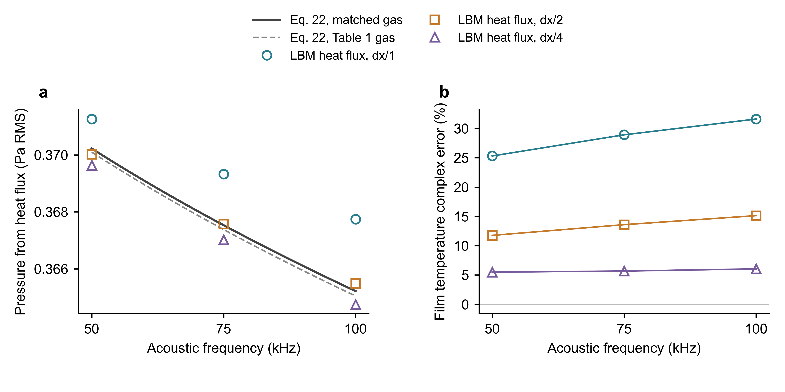

# Lim 近场声压：LBM 热流换算对照与网格诊断

日期：2026-09-18。用户目标：依据本地 Lim 论文及 LIM.md，用 LBM 结果对照近场公式。

## 1. 本次验证的量

LBM 独立演化薄膜与气体，以实际壁面能量交换得到单侧热流复幅，再使用紧致热层关系

$$
\hat p_{q}(x)\simeq\frac{\gamma-1}{c_0}\hat q_g''\exp(-i\omega x/c_0),
\qquad p_{q,\mathrm{rms}}=|\hat p_q|/\sqrt2
$$

与论文式 (22) **直接计算的 RMS 声压**对照；同时对照精确解的膜温、热流，以及式 (9) 在
指定观察位置的完整复声压。对照不是仅将 LBM 和 Lim 的热流都乘同一系数。

这是 **LBM 热流 + 解析声传播关系的混合验证**。当前气体域封闭且周期，真实 LBM
压力探针包含盒内压缩与反射。`p_probe`、`p_box` 单独保存，不当作开放近场声压。
观察距离 0.115 m 只用于解析传播和近场条件检查，LBM 气体计算域并未延伸到该位置。

## 2. 原文、公式与参数核查

来源为用户提供的原始 PDF。作者 C. W. Lim、L. H. Tong、Y. C. Li，题名
*Theory of suspended carbon nanotube thinfilm as a thermal-acoustic source*，
Journal of Sound and Vibration 332 (2013) **5451–5461**，DOI `10.1016/j.jsv.2013.05.020`。
原文 PDF 第 5 页（印刷页 5454）为式 (11)–(20) 和 Table 1；第 6 页（5455）为式 (21)、(22)
及 Fig. 2；第 7 页（5456）讨论近场 Rayleigh 条件。

### 2.1 统一约定

| 物理量 | 本次采用的定义 |
|---|---|
| 时间 | 实部 `Re[hat × exp(+iωt)]` |
| f | 声频；仅正弦电流激励时为电频的两倍 |
| 平均电功率 | `P_in=0.85 W`；谐波复幅为 `−P_in` |
| 膜单侧/投影面积 | `s=9×10⁻⁴ m²` |
| LBM 面功率复幅 | `−P_in/s=−944.444... W/m²` |
| 面积热容 | `C_A=c_s=10⁻³ J/(m² K)`，作为明确的 CNT 单层量级假设 |
| 热损 | 单侧 `β₀=16 W/(m² K)`，膜 ODE 使用双侧 `G=32 W/(m² K)` |
| 热流 | 从薄膜向气体为正，单侧，时间区间平均 |
| 热导纳 | `M` 的单位为 m⁻¹；实际热导纳 `Y_g=κM` 的单位为 W/(m² K) |
| 声压 | 峰值复幅取模后除以 √2 得 RMS；不额外施加 −3.01 dB 修正 |

运行仅施加零均值 AC 分量；没有复现平均焦耳热导致的直流温升和物性变化。
`c_s=10⁻³` 是所选明确工况，不能声称对 Fig. 2 的实验薄膜进行了参数反演。

### 2.2 不直接照抄的印刷/总结问题

- 原文式 (20) 实部的根号分母印刷为 κ，按量纲与式 (18)、(22) 应使用 α。
- 原文式 (19)/A.14 最后一行的负号与前面的定义不一致：
  `d₁≈−i(γ−1)κω/c₀²`，`σ₂≈iω/c₀`，所以 `−d₁σ₁/σ₂≈+(γ−1)κσ₁/c₀`。
  出射分支应为 `p_hat≈+(γ−1)q_hat/c₀`。论文式 (21) 的相位也与此正号一致。
  新回归直接从式 (9)–(12) 计算出射系数，排除 180° 相位错误。这个符号问题不影响式 (22) 的 RMS。
- 用户总结中关于 Fig. 2 额外除以 √2 才吻合实验点的解释，本轮未做实验点数字化核验，
  不将它作为修改 RMS 定义的依据。
- 用户的 LIM.md 与原始 PDF 均保留原样；核查结论记录于本报告。

### 2.3 气体常数口径

LBM 基线使用 `ρ₀=1.177 kg/m³`、`T₀=300 K`、`c₀=347 m/s`、`γ=1.4`、
`cp=1003.408333... J/(kg K)`、`κ=0.0263 W/(m K)`。
实际 EOS 压强为 **101229.56642857143 Pa**，而配置名义 p0 为 101325 Pa。
本次精确参照用实际 EOS 压强，满足 `c₀²=γp₀/ρ₀` 和理想气体 cp 关系。

原文 Table 1 的打印常数另算一条式 (22) 曲线，保留其舍入不一致；它不替代 LBM
匹配常数对照。代码中旧的 1.0130 倍常数差仍是两种参考实现的历史口径关系，
不能当作对本次数据的经验修正系数。

## 3. 数值设置与审计

- 频率：50、75、100 kHz；每点三个声周期，后两个周期分别拟合，保留全部九个网格算例。
- 网格：nx=1；ny=64、128、256；dx=2.61175、1.305875、0.6529375 μm。
  dt 与 dx 同比缩小；物理域高固定为 167.152 μm。
- 壁面：默认对称 mass-neutral 保守耦合；局部 Sutherland 输运。不添加热流增益或经验反馈。
- 拟合：常量与线性趋势 + 1、2、3 次谐波；温度和压力用端点时刻，热流去掉首个占位值后用区间中点。
- 守恒：分别记录膜储能、气体实际能量、输入功与热损，检查膜与总能量，不以同一残差相互代替。
- 预设诊断线：幅值 5%、相位 5°，相邻周期复幅变化 1%，积分能量残差 10⁻⁶、质量漂移 10⁻¹⁰。
  这些是本次算例检查线，不是任意器件误差界。

Rayleigh 距离分别约 129.68、194.52、259.37 mm，均大于 115 mm，符合所选近场条件。
加密同时缩小 dx 和 dt，因而此处只能称**联合网格/时间步收敛检查**，不能独立测定空间或时间阶数。

## 4. 实测结果

| 声频 (kHz) | 加密倍数 | 换算声压 RMS (Pa) | 式 (22) RMS (Pa) | 声压误差 (%) | 膜温幅值误差 (%) | 膜温相位误差 (°) |
|---|---|---|---|---|---|---|
| 50 | 1 | 0.3712605 | 0.3702258 | +0.2795 | -18.3466 | -11.0725 |
| 50 | 2 | 0.3700239 | 0.3702258 | -0.0545 | -6.1115 | -5.9458 |
| 50 | 4 | 0.3696384 | 0.3702258 | -0.1587 | -0.3616 | -3.1486 |
| 75 | 1 | 0.3693248 | 0.3675310 | +0.4881 | -22.4810 | -11.8604 |
| 75 | 2 | 0.3675720 | 0.3675310 | +0.0111 | -8.4879 | -6.3608 |
| 75 | 4 | 0.3670176 | 0.3675310 | -0.1397 | -1.5800 | -3.1498 |
| 100 | 1 | 0.3677415 | 0.3652173 | +0.6912 | -25.5209 | -12.4076 |
| 100 | 2 | 0.3654873 | 0.3652173 | +0.0739 | -10.2868 | -6.7146 |
| 100 | 4 | 0.3647528 | 0.3652173 | -0.1272 | -2.4591 | -3.2043 |

四倍加密的三点均通过上述逐项诊断线：声压相对式 (22) 的最大幅值误差为 0.1587%；膜温最大幅值误差 2.4591%，最大相位误差 3.2043°。

全部九点：总能量积分相对残差最大 1.294e-11，质量相对漂移最大 6.017e-14；相邻周期热流复幅变化最大 0.0322%，膜温最大 0.0929%。

四倍加密时，与 x=0.115 m 处的精确式 (9) 比较，换算声压的最大幅值误差为 0.3604%，相位误差为 0.2429°；此比较仍含解析传播假设。



热流换算声压在粗网格就接近解析值，不能据此忽略膜温误差。频域能量关系为

$$
2\hat q_g''=\hat P-(G+i\omega C_A)\hat T_s.
$$

当输入功的大部分传给气体时，热流对膜温误差不敏感。原网格的声压吻合与膜温偏差
可以同时出现，不能称为全链路独立验证。三档网格显示膜温误差随加密明显减小；
声压幅值误差并非每一级都单调减小，不能据接近零的某一点选择最佳网格。

本轮没有修改碰撞核、热壁或耦合算法。

## 5. 运行与文件

在仓库根目录使用 `.venv/Scripts/python.exe`：

```powershell
python -m scripts.verify_lim_nearfield --output Compute/lim_nearfield/new_r1_r2 --frequencies 50000 75000 100000 --refinements 1 2
python -m scripts.verify_lim_nearfield --output Compute/lim_nearfield/new_r4 --frequencies 50000 75000 100000 --refinements 4
python -m scripts.plot_lim_nearfield --input Compute/lim_nearfield/20260918_r1_r2/raw/summary.json Compute/lim_nearfield/20260918_r4/raw/summary.json --output Compute/lim_nearfield/20260918_r1_r2 --overwrite
```

重新运行需使用新的输出目录名；禁止覆盖已有仿真目录。

| 路径 | 用途 |
|---|---|
| [两级扫描](../Compute/lim_nearfield/20260918_r1_r2/raw/summary.json) | 参数、运行时间、源码哈希、逐算例检查 |
| [四倍加密扫描](../Compute/lim_nearfield/20260918_r4/raw/summary.json) | 第三档网格的独立运行记录 |
| 每个 `raw/f*_r*` 子目录 | effective.yaml、完整 trajectory.npz 和 summary.json |
| 各运行 `raw/source_snapshot.zip` | 运行时源码快照；后续注释或诊断修改不覆盖该快照 |
| [图与源数据](../Compute/lim_nearfield/20260918_r1_r2/final/) | PNG、PDF、SVG、全部九点 CSV；旧排版检查留在原 results 批次 |
| [旧入口 10 kHz 复跑](../Compute/lim2013/baseline_20260918/raw/summary.json) | 本轮开始时复跑的历史入口；尚用名义 p0，且保留原始混合幅值比，勿用作新口径证据 |

旧入口 `verify_lim2013.py` 已同步修正：精确参照取实际 EOS p0，盒压/辐射比改为峰值/峰值。
默认 10 kHz、ny=64 下约 66 倍；旧 93 倍是盒压峰值除以辐射 RMS 的结果。

正式数据现位于 `Compute/lim_nearfield/` 下各历史批次的 `raw/`，图和汇总表位于 `final/`。
旧说明与排版检查仍留在原 `results/lim_nearfield_20260918/_work/` 等目录。
现行绘图仅在显式传入 `--qa-tools` 时生成排版检查；重跑求解使用新批次名。
原始数据与图件属于忽略 Git 跟踪的运行输出；报告为当前结论的入口。

## 6. 检查与结论边界

- 全量回归：`python -m pytest -q`，**113 passed，40.47 s**。
  新增三个检查覆盖实际 EOS、区间均值的中点相位以及原文出射分支的压力符号。
- 九个实际算例全部完成，四倍加密的三点均通过所有预设诊断线；粗网格膜温未通过的结果完整保留。
- 图件：最终绘图区对齐通过；PDF 最小字体 8 pt；最终碰撞审计 0 fail / 0 warn。
  逐面板及整图目检通过。PNG 为 600 dpi 预览，PDF/SVG 文字可编辑；没有要求 TIFF 投稿文件。
- 文档烟测退出码 0，保留一条旧规范提醒：PROJECT_CONTEXT 不引用 PhaseN_STATUS。
  本仓未迁入旧仓阶段状态，因此明确采用当前核心链路/专题报告入口，不虚构阶段验收文件。
- `git diff --check` 通过。原始 PDF、用户 LIM.md 和本轮开始前已有的常数注释修订均保留。

当前可支持：在所选线性 AC 工况、空气参数、三处频率与已检查网格下，
LBM 实际热交换换算的近场 RMS 声压与 Lim 式 (22) 一致，且加密改善膜温幅相。

尚不能支持：开放域 LBM 压力探针直接复现式 (21)/(22)、有限宽膜边缘衍射、三维辐射、
包含直流温升的完整电热声器件响应，或整个 50–100 kHz 连续频段都已完成数值验证。
要推进到直接声压验证，下一步需建立开放/无反射边界并独立测量反射，再在热层外的
多个位置同时检验压力幅值与传播相位；单靠热流换算不满足这一目标。

后续进展：已另建给定膜温的单侧开放平面验证，直接压力对照 Lim 给温精确解，
结果与边界适用范围见 [开放域专项报告](OPEN_PLANAR_20260918.md)。
这不改变本报告热流换算证据的性质，也不表示电功率驱动下的开放域 Eq. (22)
整链路或有限尺寸薄膜已经认证。
