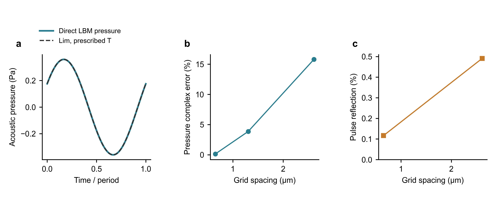

# 单侧给温开放域：直接压力验证

## 任务与几何

本任务实现给定薄膜温度后，由 LBM 演化空气的温度、密度、速度和压力。
声压直接取气体分布恢复的 `p=rho*theta`，不是由壁面热流换算。
先验证正方形薄膜中心附近的均匀平面近似：膜位于物理 xy 平面的 z=0，
只算 z>0 空气；代码 y 即物理 z。横向 nx=1、周期，只表达均匀平面波。
没有薄膜边缘、有限面积衍射或三维声场；下侧空气未重复计入本域。

入口为 [PlanarOpenSolver](../core/planar_open_solver.py) 与
[verify_planar_open](../scripts/verify_planar_open.py)，旧周期膜 ODE 链路独立保留。
参数与验证结果保存在 [正式运行集](../Compute/open_planar/20260918/raw/)。
本轮已完成平面基线验证：50 kHz 中等/精细网格及 75/100 kHz 精细网格通过本次判据；
原始粗网格的幅值精度未通过。下文只在这些工况内接受直接压力结果。

## 边界与热量进入方式

- 空气初始 T0=300 K、速度为零、rho0=1.177 kg/m³。背景压力使用实际 EOS
  101229.5664 Pa，不另将配置中的 101325 Pa 强制施加到压力场。
- 膜温 `Ts=300+0.1*r(t)*sin(2*pi*f*t)` K；r 在两周期内由半余弦平滑升至 1。
  f 是温度/声学频率。没有求解电阻或焦耳热，也没有薄膜面积热容 ODE。
  这是受控给温验证；不能据此宣称已复现电功率到声压的整条器件链路。
  本算例只考察零均值小信号 AC 响应，不包含焦耳热的正 DC 温升或自然对流；
  温控边界允许半周期向空气供热、另半周期从空气吸热。
- 底部采用全容纳漫反射热壁：所有从壁面进入空气的 f/g 使用 Ts 的平衡分布，
  壁密度由离散入射质量等于出射质量确定。因此壁面不漏质量，也不指定声压。
  壁位于首个气体格中心下方 dx/2；D2Q37 中跨越两、三层的链接也全部重建。
  **首格气体温度不是壁面温度**。漫反射的有限网格/动理学温度跳跃需要网格收敛检查，
  不能把它等同于已经精确实现连续介质的无温度跳跃条件。
- 顶部采用线性正入射声学特征出口：保留 `W+=p'+rho0*c0*u_z`，令外部入射
  `W-=p'-rho0*c0*u_z=0`；保留内部熵模态 `rho'-p'/c0²` 和非平衡分布。
  由此重建缺失链接所需的 rho/u/T，避免将气体温度或总压固定在背景值。
  这是静止背景小振幅平面验证的近似特征出口，不是完整非线性、多维含黏性 CBC。
  多速边界及特征分解的依据参见
  [Klass、Gabbana 与 Bartel (2024)](https://arxiv.org/html/2307.16766v2)；
  本实现没有照搬该文单原子气体参数，而使用本仓 gamma=1.4 的 f/g 气体。
- 法向迁移无周期回绕。越界布居先留下 NaN，全部边界处理后必须有限；不使用中间热沉或吸收层。

热量通过壁出入分布携带的总能量差进入空气。每个时间区间独立累计：

`ΔE_gas = ΔE_wall + ΔE_top`，`ΔM_gas = ΔM_wall + ΔM_top`，其中 `ΔM_wall=0`。

顶部项正值表示进入域内，包含布居所携带的全部能量；不能只减去顶部导热通量。
`q_wall=ΔE_wall/dt` 是单侧热流，属于区间中点，不乘 2。壁温也在中点采样；
压力、温度及总能量场在步末读取。代码同时保留逐步及累计守恒残差。

## 参照与判据

直接压力使用 Lim 精确给温解 Eq. (9)，输入 `T_hat=-i*0.1 K`；
单侧热流另与精确热导纳对照。此处不使用需要膜功率/热容的 Eq. (22) 作为给温输入。
所有参照只在仿真后计算，不进入源项或边界。

压力探针约位于 z=0.12、0.30、0.60 mm；使用真实格点位置代入参照。
末两个周期分别进行趋势加三阶谐波拟合，报告复幅、相位及相邻周期变化。
当前算例判据：压力幅值误差 <5%、相位误差 <5°、相邻周期复幅变化 <1%；
独立高斯声脉冲的反射幅值比 <1%。这些阈值仅是本次验证门槛，不是器件精度保证。
Lim 解不含本仓的全部黏性效应；残余差异也不能全部归因于网格。

## 运行证据

运行日期：2026-09-18；最终记录复核：2026-09-19。所有正式算例使用同一碰撞核、链接迁移、热壁、出口及 Lim
参照源码；逐文件 SHA-256 在各算例的 manifest 中，图表输入摘要哈希另存于
[supplementary_checks.json](../Compute/open_planar/20260918/raw/plot_data/supplementary_checks.json)。

50 kHz 的三网格均运行六周期，物理域长固定为 1.00030025 mm。
以下压力误差均为三个探针中的最大绝对值，幅值采用峰值/峰值比较；
RMS 统一除以 sqrt(2)，相对误差不变。

| 加密倍数 | dx (µm) | ny | 声压幅值误差 | 相位误差 | 相邻周期复幅变化 | 判定 |
|---|---:|---:|---:|---:|---:|---|
| 1 | 2.611750 | 383 | 13.2126% | 4.6863° | 0.000238% | 幅值不通过 |
| 2 | 1.305875 | 766 | 3.0407% | 1.3487° | 0.000259% | 通过本次判据 |
| 4 | 0.652938 | 1532 | 0.0512% | 0.0731° | 0.000267% | 通过本次判据 |

精细网格 z=0.3000248 mm 处直接声压峰值为 **0.3591306 Pa**，Lim 精确参照为
**0.3593129 Pa**；对应 RMS 分别约 0.253944 和 0.254073 Pa。
精细网格单侧壁面热流幅值误差 −0.0338%、相位误差 −0.0484°。
热层 `0<z<=5*delta_T` 内的温度复幅最大误差，以膜温振幅 0.1 K 归一化，
依次为 **12.337%、3.623%、0.794%**，支持温度场也随网格加密改善。
这里不是按每个远离膜面的小温度幅值归一化，以免在指数衰减尾部放大相对误差。

| 精细网格频率 | 周期数 | 声压幅值误差 | 相位误差 | 相邻周期复幅变化 | 热层温度误差/膜温振幅 |
|---|---:|---:|---:|---:|---:|
| 75 kHz | 4 | 0.0623% | 0.0968° | 0.4113% | 0.959% |
| 100 kHz | 4 | 0.0657% | 0.1219° | 0.3752% | 1.093% |

这两组满足预定 5%/5°/1% 门槛，但其相邻周期变化大于声压对照偏差。
因此它们是频率检查，不据上述小偏差宣称完整误差界限小于 0.1%。
同样，三网格的参照偏差下降不等于已经量化连续网格极限，未用三点强行拟合收敛阶。

开放边界的独立检查：

- 高斯声脉冲：相对密度峰值 1e-5，中心 z=0.3H，标准差 0.045H，探针约 z=0.65H；
  从分离的出射/反射时间窗提取 `(p'±rho0*c0*u_z)/2`。粗、细网格反射比
  分别为 **0.4907%、0.1164%**，均小于 1%。这不是任意频率和入射角的反射保证。
- 中等网格将域长加倍到 2.0006005 mm，比较共同的第 3–4 周期窗口：
  三个探针的复幅变化最大 **0.05267%**，幅值变化最大 0.04552%，相位变化最大 0.02131°。
- 所有热算例的壁面净质量交换绝对值不超过约 4.45e-16 LU/步；
  最大逐步质量残差约 5.54e-13 LU、累计质量残差约 1.32e-10 LU；
  最大逐步能量残差约 1.20e-13 J/m²、累计能量残差约 4.65e-12 J/m²。
  f/g 布居均保持正值，没有裁剪或吸收层能量源项。



图 a：50 kHz 精细网格约 0.30 mm 处末周期直接压力，仅去拟合均值和线性趋势；
b：50 kHz 三探针中最大复幅误差；c：独立脉冲反射比。连线只引导观察。
全部六组热算例的 18 个探针数据见
[source_data.csv](../Compute/open_planar/20260918/final/source_data.csv)，
可编辑图为 [PDF](../Compute/open_planar/20260918/final/validation.pdf) /
[SVG](../Compute/open_planar/20260918/final/validation.svg)。

接受范围：小振幅给温、静止背景、正入射平面近场。后续若恢复电功率驱动，需要把
薄膜储能与此单侧边界的真实交换量重新耦合；若研究方形薄膜边缘、下侧非对称环境
或三维辐射，需要另外构造并验证相应几何与边界，不能直接外推当前结论。

## 代码回归与复现

新增回归覆盖三层链接、无回绕、静止态不发声、壁不透质量、开放能量收支及独立声脉冲。
为减少精细网格开销，碰撞中零低阶矩的最小范数投影使用固定矩阵缓存：
中心矩平移只增加已约束为零的低阶矩，因此与原逐格 Gram 求解代数等价。
有限速度下逐布居对照测试守护该结论，不使用小流速截断，也不改输运参数。

本轮完整回归 **121 passed**；最终专项复查 **8 passed**。文档检查通过，
仅保留本迁移仓无 `PhaseN_STATUS` 指针的既有警告，不据此补建虚假的阶段验收。
图件经过源码预检、面板对齐、PDF 字号、碰撞及人工可视检查；PNG 是报告预览，
未要求 TIFF 投稿栅格图。历史开发时曾解压源码复跑声脉冲；这不是现行算例工作流的要求。

本批次各正式算例在 `raw/<case>/` 保存 `manifest.json`、`effective.yaml`、
`trajectory.npz` 与 `summary.json`；共同源码位于 `raw/source_snapshot.zip`。
`final/` 保存图和汇总 CSV；`raw/plot_data/` 保存波形、反射和补充数值检查。
以上正式数据现位于 `Compute/open_planar/20260918/`；原有开发试跑、排版检查、
旧说明和重复源码副本仍留在 `results/open_planar_20260918/_work/`，本次未移动或删除。
manifest 中的命令路径是运行时的历史记录。此次整理未修改物理数据或结论。

```powershell
python -m scripts.verify_planar_open --mode thermal --refine 4 --frequency 50000 --output Compute/open_planar/new_50k
python -m scripts.verify_planar_open --mode pulse --refine 4 --output Compute/open_planar/new_pulse
```

`--output` 指批次根目录，数据写入其 `raw/`。两条命令均要求新的数据目录；
也可在同一批次中用 `--case <算例名>` 区分算例。常规配置运行使用 `scripts.run_compute`；
运行时只记录版本信息与公共源码哈希，不创建源码归档；完整说明见根 README。
默认 refine=4、给温算例运行六周期，细网格在本次 CPU/NumPy
实现上属于长算例，逐周期输出进度。完整回归为 `python -m pytest -q`。
图表入口为 `scripts.plot_planar_open`，`--input` 与 `--output` 均可用正式批次根目录。
重画已有图件须加 `--overwrite`；图件写入 `final/`。
仅显式传入 `--qa-tools` 才生成 `_work/qa/`；常规运行不生成排版检查。
